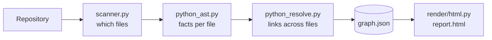

# How wiringmap works

This page is for people who want to understand or change wiringmap itself. To *use* it,
see the [README](../README.md).

## Principles

- **Offline by default.** Analysis is static: wiringmap reads files and never runs the
  code it maps. The report is one HTML file with every library inlined, so opening it
  makes no network requests.
- **Useful without AI.** Everything in the report comes from static analysis. AI
  features are optional extras on top.
- **Honest about uncertainty.** Python is dynamic, so every call link records how it
  was found. Calls that cannot be linked are counted, never guessed silently.
- **Easy to contribute to.** Python with [uv](https://docs.astral.sh/uv/) only. The
  viewer is plain JavaScript with no build step, so there is no Node toolchain to set up.

## Pipeline



| Step | Module | Job |
|---|---|---|
| Scan | `scanner.py` | Walks the repository the way git sees it: honours every `.gitignore` and `.git/info/exclude`, and skips hidden folders, virtualenvs, build output and symlinks. Detects each file's language from its name. |
| Extract | `parsers/python_ast.py` | Reads one file with the standard `ast` module and records what it defines, imports and calls, plus type hints (annotations, `x = Class()`, attributes set in `__init__`). It needs no knowledge of other files, so files can be processed in any order. A file that fails to parse is recorded, and the scan carries on. |
| Resolve | `parsers/python_resolve.py` | Gives every module its import name, then links names across files: imports, relative imports, re-exports through `__init__.py`, star imports, inheritance and decorators. Calls are linked through scopes, imports and simple type inference. |
| Build | `builder.py` | Runs the steps above and adds directory and non-Python file nodes. |
| Render | `render/html.py` | Inlines the graph, optional source code, the viewer and its libraries into one HTML file. |

## The code graph

Everything flows through one data structure, `CodeGraph` (`graph/model.py`), stored as
`graph.json`. Its format is documented in [graph-schema.md](graph-schema.md). Nodes are
directories, files, modules, classes, functions, methods and external packages. Edges
are `contains`, `imports`, `calls`, `inherits` and `decorates`. Output is sorted, so
the same code always gives the same file, which makes graphs safe to diff.

### How calls are linked

For each call, the resolver tries in order:

1. `super().m()` and `self.m()` / `cls.m()`: method lookup through the class's
   inheritance chain inside the project.
2. A local variable with a known type: annotated parameters, `x = Class(...)`, or the
   return annotation of a factory function.
3. The name itself, through local definitions, imports, module-level names and
   builtins, then attribute by attribute (`pkg.module.func`, `Class.method`).
4. Module-level objects with a known type (`registry = Registry()` imported elsewhere).
5. As a last resort, a method name that exists exactly once in the project and is not a
   common name like `get` or `run`. This is marked `guessed`.

Calls into other packages are recorded per function (`external_calls`), calls to
builtins are ignored, and everything else is counted as `unresolved_calls`.

## Comparing versions: `wiringmap diff`

| Module | Job |
|---|---|
| `gitsnap.py` | Reads a past version out of git without touching the working tree: it lists the commit's files (`git ls-tree`) and fetches only the ones the scanner reads (`git cat-file --batch`). `git archive` is avoided because `export-ignore` would hide files |
| `diff.py` | Compares two graphs. Renames and moves are matched by the code `hash`; duplicate logic by `shape`; import cycles with Tarjan's algorithm on the file import graph |
| `diff_report.py` | Turns the result into Markdown for the terminal, pull requests and AI agents |

Static analysis cannot link every call, so the diff is careful about claims that rest
on a missing link. For example, a function is only reported as having "lost all its
callers" when no unlinked call anywhere in the project has its name. Classes and
functions inside a file that does not parse are treated as unknown, not as removed.

## Following a function: `wiringmap flow`

`flow.py` walks the call edges from one function, down (what it calls, ordered by the
line of each call) or up (what calls it). A function appears once; later mentions
point back to it, and recursion is marked instead of followed. Depth, a per-step limit
and a total budget keep the result readable, and the counts of what was left out are
reported. When more than three callers are in tests, examples or docs, they are folded
into one line so the app callers stay visible.

The report's flow view (`buildFlowView` in `app.js`) builds the same structure in the
browser and places it in columns, one per step, so it reads left to right.

## The viewer

`render/static/` holds the template (`report.html`), styles (`app.css`) and the app
(`app.js`). It uses [Preact](https://preactjs.com) and
[htm](https://github.com/developit/htm) for components (React-style, but written in
plain JavaScript), and [Cytoscape.js](https://js.cytoscape.org) with the
[fcose](https://github.com/iVis-at-Bilkent/cytoscape.js-fcose) layout for the map. The
libraries are vendored in `render/static/vendor/` (versions in its README).

- **Map:** Python files inside folder groups. Big projects start with folders collapsed,
  choosing what to open by how many boxes fit on screen. Test, docs and migration
  folders start closed. After fcose runs, two extra passes push apart overlapping boxes
  and pack unconnected groups into rows.
- **Inspector:** details for whatever is selected, built from the graph index in the
  browser.
- **Search:** fuzzy matching over files, classes and functions.

The viewer is tested by building reports and opening them in a browser. A quick check:

```bash
uv run wiringmap build . --open
```

### Size limits

Measured with the bundled libraries: laying out and drawing about 300 boxes is instant,
around 1,500 gets sluggish, and tens of thousands is unusable. That is why the map works
at file and folder level, and why function-level views must start from one function
and expand on request, rather than drawing everything.

## Adding support for more languages or frameworks

A language parser produces the same per-file facts as `python_ast.py` and lets a
resolver link them into the graph. Framework knowledge (routes, dependency injection,
ORM models) belongs in optional plugins that add nodes or edges to the graph, so the
core stays general.
